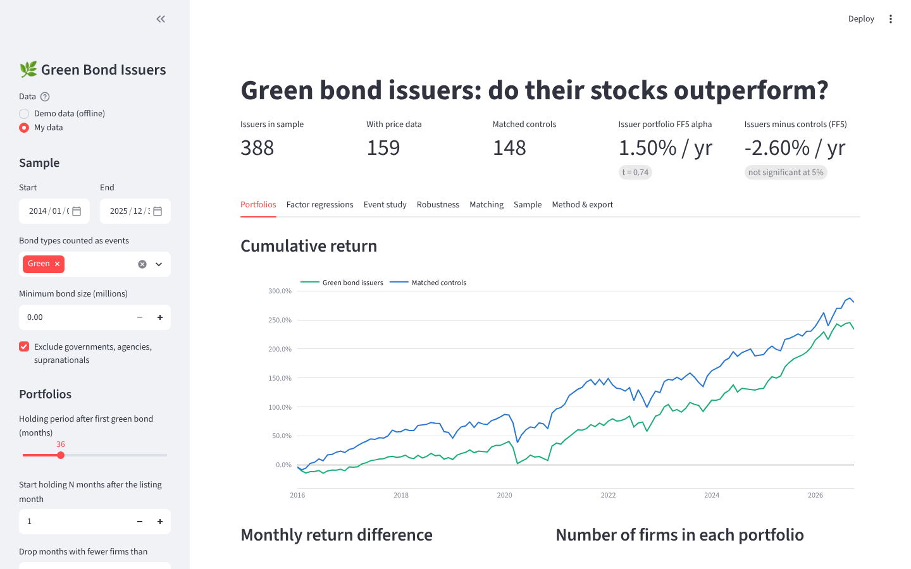
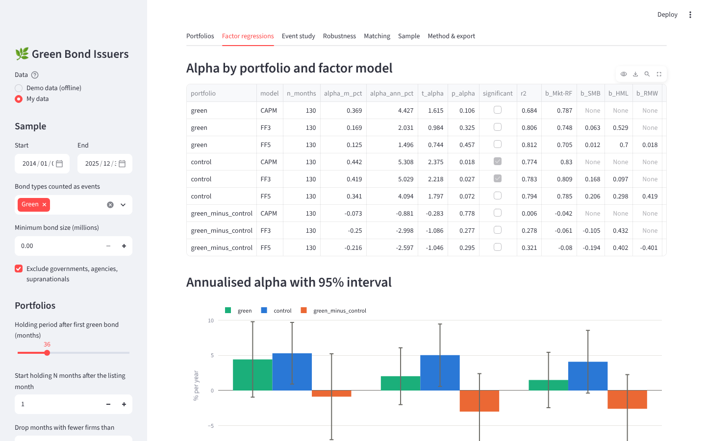

# Green Bond Issuers: do their stocks outperform?

An interactive research tool, with a first set of real-data results, on one question:

> Do investors benefit from holding the shares of companies that issue green bonds?

It follows the design of Badía, Cortez and Silva (2024, *Economics Letters*): compare a portfolio of green bond issuers with matched non-issuers and measure risk-adjusted returns with Fama–French factor models. An event study of the share-price reaction around each issuer's first green bond listing is added.

The project has two Python files:

| File | What it does |
|---|---|
| `greenbond_engine.py` | Loads and filters the bond list, matches issuers to stock tickers, downloads prices and factors, builds portfolios, runs the regressions and the event study, and includes demo data and self-tests |
| `app.py` | Streamlit dashboard: every setting is a box, slider or menu, and results update when you change it |

## Screenshots

Dashboard running on the real data (default settings).

**Cumulative returns of green bond issuers and their matched controls**


**Alpha by portfolio and factor model (CAPM, FF3, FF5)**


**Share-price reaction around the first green bond listing**


**Robustness: issuers-minus-controls alpha across holding periods and winsorising**


## Running it

```
pip install -r requirements.txt
python greenbond_engine.py --selftest     # 10 checks, about 5 seconds
streamlit run app.py
```

The dashboard opens in your browser with three data modes:

| Mode | What it shows | Needs |
|---|---|---|
| **Saved results (real data)** | The real-data results below, stored in `data/saved_results.json`. Settings are shown but locked; the factor model and significance level can still be switched | Nothing extra (works online) |
| **Demo data (offline)** | Synthetic stocks with known true effects, to see how the method behaves | Nothing |
| **My data** | Recomputes everything from the files in `data/`, with every setting open | Share prices (`prices.csv.gz`, or the *Download prices* button) |

Yahoo Finance prices cannot be redistributed, so they are not in this repository. **My data** downloads them for you (free, a few minutes). To refresh the saved results after changing the data:

```
python greenbond_engine.py --save-snapshot data/saved_results.json
```

## Data

All sources are free.

| File in `data/` | Source | Notes |
|---|---|---|
| `Euronext-Green-Bond-List.xlsx` | [Euronext ESG bonds list](https://live.euronext.com/en/products/fixed-income/esg-bonds), downloaded 2 November 2026 | 4,239 ESG bonds listed on Euronext venues, 2012–2026 |
| `issuer_tickers.csv` | Yahoo Finance search, then checked by hand | Issuer → stock ticker. The `source` column says `manual` for the 99 rows corrected or added by hand, and `note` says why |
| `control_universe.csv` | Index constituent lists (CAC 40, DAX, FTSE MIB, IBEX 35, AEX, BEL 20, OMXS30, OBX, OMXH25, OMXC25, PSI) | 318 candidate control firms |
| `prices.csv.gz` | Yahoo Finance, daily adjusted close, 2009–2026 | 453 tickers. **Not included in the repository** (Yahoo terms); the dashboard downloads it |
| `saved_results.json` | Output of this project | Results of the default run (no prices), shown in *Saved results* mode |
| `Europe_5_Factors_*_CSV.zip` | [Kenneth French data library](https://mba.tuck.dartmouth.edu/pages/faculty/ken.french/data_library.html) | European five factors, monthly and daily |

The dashboard can rebuild the ticker table (Yahoo search) and download fresh prices and factors itself. Upload or replace any file in the sidebar.

## Method

1. **Events.** An issuer enters on the listing date of its first green bond between 2014 and 2025. Governments, regions, agencies, supranationals and securitisation vehicles are excluded by name patterns. Financing subsidiaries of listed groups (for example *Enel Finance International*) are mapped to the listed parent.
2. **Matching.** Each issuer gets one control firm: the non-issuer whose market beta and volatility over the 36 months before the listing are closest (standardised distance, without replacement).
3. **Portfolios.** Calendar-time, equal-weighted. Each issuer is held from the month after its listing for 36 months, and its control over the same months. Monthly returns are winsorised at 1% in each tail.
4. **Risk adjustment.** Monthly excess returns are regressed on CAPM, FF3 and FF5 (European factors), with Newey–West standard errors (6 lags).
5. **Event study.** A market model is estimated over trading days −250 to −30, and abnormal returns are summed over the windows [−1, 1], [0, 5] and [−5, 5].

All of these choices can be changed in the dashboard.

## First results (default settings)

Sample: 388 non-public green bond issuers; 159 firms with share prices (first green bond between May 2014 and November 2025); 148 with a matched control. Portfolios run from January 2016 to September 2026 (130 months).

**Annualised alpha, % per year (t-statistic)**

| Portfolio | CAPM | FF3 | FF5 |
|---|---|---|---|
| Green bond issuers | 4.43 (1.62) | 2.03 (0.98) | 1.50 (0.74) |
| Matched controls | 5.31 (2.37) | 5.03 (2.22) | 4.09 (1.80) |
| Issuers minus controls | −0.88 (−0.28) | −3.00 (−1.09) | −2.60 (−1.05) |

**Issuers-minus-controls FF5 alpha across holding periods and winsorising (% per year, t-statistic)**

| Holding period | none | 1% | 5% |
|---|---|---|---|
| 12 months | 6.46 (2.29) | 6.59 (2.32) | 3.61 (1.55) |
| 24 months | −2.85 (−0.95) | −2.31 (−0.95) | −2.68 (−1.52) |
| 36 months | −2.13 (−0.68) | −2.60 (−1.05) | −2.42 (−1.52) |
| 60 months | −3.78 (−1.25) | −3.84 (−1.63) | −3.36 (−2.24) |

**Event study around the listing date** (149 events)

| Window | Mean CAR | t-statistic | Share positive |
|---|---|---|---|
| [−1, 1] | −0.28% | −1.93 | 41% |
| [0, 5] | −0.14% | −0.55 | 46% |
| [−5, 5] | −0.27% | −0.71 | 44% |

**Reading the results.** Green bond issuers earn returns close to what the factor models predict (FF5 alpha 1.5% a year, not significant). Compared with matched controls, they do better in the first year after their first green bond (+6.5% a year, t ≈ 2.3) and slightly worse at longer horizons, mostly without statistical significance. The listing day itself comes with a small negative reaction. These are preliminary results with clear limitations, listed below.

## Limitations

* **Survivorship in the controls.** Control firms come from *current* index lists, so they are firms that did well enough to stay in, or join, an index. This is the likely reason the control portfolio shows a positive alpha (FF5 4.1% a year), and it biases issuers-minus-controls downwards. A point-in-time constituent list would fix this.
* **Missing delisted issuers.** Firms that were taken over or delisted (for example Neoen, Greenvolt, CNP Assurances) have no Yahoo prices and drop out.
* **Listing date ≠ announcement date.** Euronext gives the listing date, which usually comes a few days after the bond is announced and priced. The average abnormal return path rises before the listing, which fits this.
* **Euronext venues only.** Bonds listed elsewhere (Luxembourg, London, Frankfurt) are not in the list, so some issuers' first green bond may be earlier than recorded here.
* **Ticker matching.** Automatic matching was checked by hand, but the table should be reviewed again before any formal use. 252 issuer names map to 240 tickers.
* **Matching** uses only beta and volatility. Matching on sector, country and size (as in the literature) needs fundamentals data.
* Yahoo prices are adjusted for splits and dividends, but data quality for small and foreign listings is not guaranteed.

## Reproducing the ticker table

```
python greenbond_engine.py --bonds data/Euronext-Green-Bond-List.xlsx --suggest-tickers my_tickers.csv
```

This searches Yahoo for every issuer and writes a table with a similarity score. Rows with `include = False` or a low score need a manual check, which the dashboard's *Sample* tab lets you do and save.

## Reference

Badía, G., Cortez, M. C. and Silva, F. (2024). Do investors benefit from investing in stocks of green bond issuers? *Economics Letters*, 242, 111859.

## Author

Saeed Samadiye. Modified the code with new data with the help of AI.
