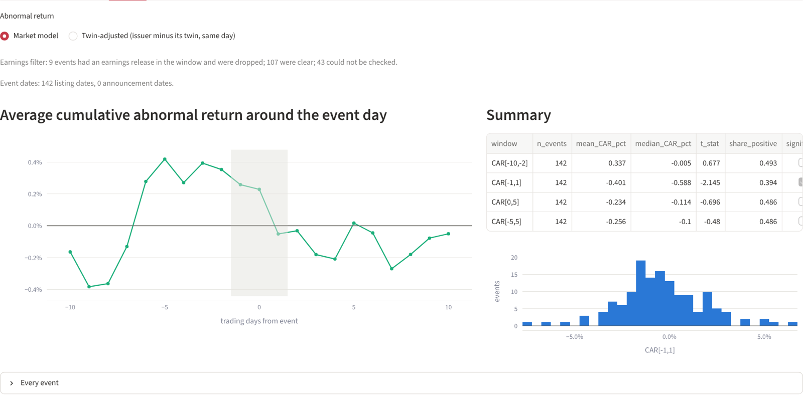
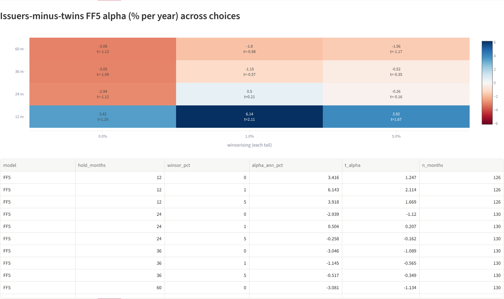
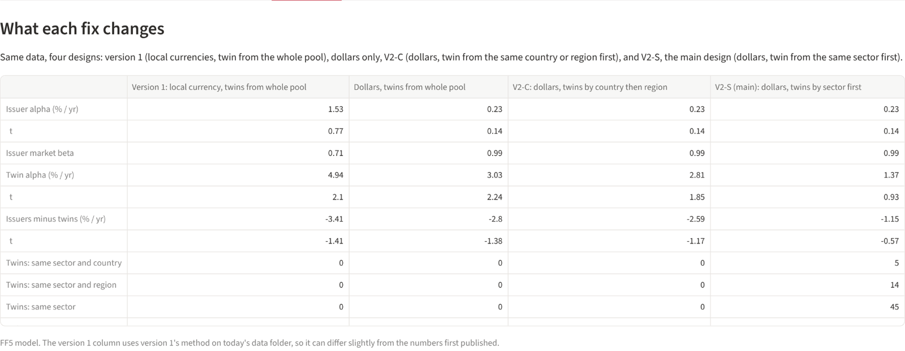

# Green Bond Issuers: do their shares outperform? (version 2)

> Do investors gain from holding the shares of companies that issue green bonds?

The project follows the design of Badía, Cortez and Silva (2024, *Economics Letters*). It builds a portfolio of green bond issuers and a portfolio of matched non-issuers ("twins"), then compares their risk-adjusted returns with Fama–French factor models. It also runs an event study of the days around each issuer's first green bond.

| File | What it does |
|---|---|
| `greenbond_engine.py` | Everything except the dashboard: loads the bond list, finds share tickers, downloads data, converts currencies, matches twins, builds portfolios, runs the regressions and the event study. Also has demo data and self-tests |
| `app.py` | Streamlit dashboard. Every setting is a box, slider or menu |

## What changed from version 1

1. **Currencies.** The Kenneth French factors and risk-free rate are in US dollars. Version 1 used share returns in each share's own currency (euros, kroner, lira and so on), so every regression mixed currencies. Version 2 converts every price to dollars with ECB reference rates before computing returns.
2. **Twins by sector, country and region.** Version 1 took the nearest firm in beta and volatility from anywhere in the pool: only 13 of 148 twins traded on the issuer's own exchange, and 10 were in the issuer's sector. Version 2 (main design, "V2-S", `match_mode = "sector_country"`) looks through these steps in order:
   1. same sector and same country;
   2. same sector and same region;
   3. same sector anywhere;
   4. same country;
   5. same region;
   6. the whole pool.

   Sector means Yahoo's 11 sectors. The regions are Nordics, Western Europe, UK and Ireland, Southern Europe, and Central and Eastern Europe. A step is used only if its best twin is close enough (standardised distance ≤ 0.25). This mirrors Badía et al., who match on industry and country. The step used is saved for every issuer.
   The alternative `match_mode = "country_region"` ("V2-C") skips the sector steps and is kept as a robustness check.
3. **Bigger pool.** The FTSE 100 (operating companies, no investment trusts) and the SMI are added to the 11 original indices.
4. **Event study.**
   - Adds twin-adjusted abnormal returns: issuer return minus twin return on the same day.
   - Adds a pre-listing window, [−10, −2].
   - Can drop events with an earnings release in [−5, 5] (`earnings_dates.csv`).
   - Can use bond announcement dates instead of listing dates, where they are filled in (`announcement_dates.csv`).
5. **Bug fix: Mondays.** Gulf markets trade on Sundays. In version 1, a Sunday row in the price file erased the Monday return of every European share in the event study. Weekend rows are now dropped before daily returns are computed.

The dashboard has a *Design comparison* tab that runs version 1's method, dollars only, V2-C and V2-S on the same data.

## Screenshots

**Portfolios**: issuers vs matched twins


**Factor regressions**: alphas and betas, Newey-West errors


**Event study**: market-model and twin-adjusted abnormal returns


**Robustness**: holding period × winsorising


**Design comparison**: what each fix changed


## Running it

```
pip install -r requirements.txt
python -m streamlit run app.py
```

The dashboard has three data modes:

| Mode | What it does | What it needs |
|---|---|---|
| **Saved results** | Shows the real-data results of the default run (V2-S). Settings are locked | Nothing: `data/saved_results.json` is in the repository |
| **Demo data** | Made-up shares with a true effect you choose, to see if the method finds it | Nothing (offline) |
| **My data** | Recomputes everything from `data/`, every setting open | The Euronext bond list and Yahoo prices, which are **not in this repository** (see below). The app asks for both the first time |

To set up **My data** on your own computer:
1. Download the Excel file from the [Euronext ESG bonds page](https://live.euronext.com/en/products/fixed-income/esg-bonds) and upload it when the app asks, or save it as `data/Euronext-Green-Bond-List.xlsx`.
2. Click **Download prices and data**. This downloads Yahoo prices, ECB exchange rates, firm country and sector, earnings dates and the latest French factors.

The same download runs from the command line:

```
python greenbond_engine.py --update-data                          # needs internet
python greenbond_engine.py --save-snapshot data/saved_results.json  # recompute the saved results
python greenbond_engine.py --selftest                             # 14 checks, offline
```

On Windows, double-clicking `run_update.bat` does both steps and writes a log to `update_log.txt`.

`--update-data` runs five independent steps. If one fails (for example Yahoo blocks a request), the others still run, and you can run it again.

## Data (`data/`)

| File | Source | In this repository? |
|---|---|---|
| `Euronext-Green-Bond-List.xlsx` | [Euronext ESG bonds list](https://live.euronext.com/en/products/fixed-income/esg-bonds), downloaded 2 Nov 2026; 4,239 ESG bonds | No (Euronext data): download it yourself |
| `prices.csv.gz` | Yahoo Finance, daily adjusted close | No (Yahoo terms): made by *Download prices and data* |
| `earnings_dates.csv` | Yahoo Finance | No (Yahoo terms): made by *Download prices and data*. Until it exists, the earnings filter is off |
| `issuer_tickers.csv` | Yahoo search, checked by hand | Yes. Issuer → share ticker |
| `control_universe.csv` | Index member lists | Yes. 433 firms: CAC 40, DAX, FTSE MIB, IBEX 35, AEX, BEL 20, OMXS30, OBX, OMXH25, OMXC25, PSI, FTSE 100, SMI |
| `firm_info.csv` | Yahoo Finance | Yes. Country, sector and trading currency per ticker |
| `ecb_fx_rates.csv` | [ECB euro reference rates](https://www.ecb.europa.eu/stats/policy_and_exchange_rates/euro_reference_exchange_rates/html/index.en.html) | Yes. Units of each currency per euro, daily. The ECB published no ISK rate in 2009–2017; that gap is filled with Yahoo's EUR/ISK rate. AED, QAR and SAR use their fixed dollar pegs |
| `announcement_dates.csv` | Fill in by hand | Yes (template). One row per issuer with its first green bond ISIN and listing date. Add the announcement date and its source; empty rows keep the listing date |
| `Europe_5_Factors_*_CSV.zip` | [Kenneth French data library](https://mba.tuck.dartmouth.edu/pages/faculty/ken.french/data_library.html) | Yes. European five factors, monthly and daily, in US dollars |
| `saved_results.json` | This project | Yes. Results of the default run, shown in *Saved results* mode (contains no prices) |

## Results (15 November 2026)

**Data used:**
- Prices to 13 November 2026, 428 of the 433 pool firms with prices.
- ECB exchange rates to 13 November 2026.
- French factors to September 2026.
- Earnings dates for 217 of 240 mapped issuers.
- No announcement dates yet.

Sample: 388 non-public green bond issuers, 159 with share prices, 148 with a twin. In V2-S, 66 of the 148 twins are in the issuer's sector. By the step that found them:

| Step | Twins |
|---|---|
| Same sector and country | 5 |
| Same sector and region | 14 |
| Same sector anywhere | 45 |
| Same country | 28 |
| Same region | 14 |
| Whole pool | 42 |

Portfolio months: December 2015 to September 2026 (130). Significance: \*\* 5%, \* 10%.

**Annualised alpha, % per year (t-statistic), V2-S**

| Portfolio | CAPM | FF3 | FF5 |
|---|---|---|---|
| Green bond issuers | 2.30 (1.16) | 0.18 (0.11) | 0.23 (0.14) |
| Twins | 2.58 (1.40) | 1.48 (0.98) | 1.37 (0.93) |
| Issuers minus twins | −0.28 (−0.13) | −1.30 (−0.59) | −1.15 (−0.57) |

**What each fix changed (FF5)**

| | Version 1 method | Dollars only | V2-C (country first) | V2-S (main) |
|---|---|---|---|---|
| Issuer alpha (% / yr) | 1.53 (t 0.77) | 0.23 (t 0.14) | 0.23 (t 0.14) | 0.23 (t 0.14) |
| Issuer market beta | 0.71 | 0.99 | 0.99 | 0.99 |
| Twin alpha (% / yr) | 4.94 (t 2.10) | 3.03 (t 2.24) | 2.81 (t 1.85) | 1.37 (t 0.93) |
| Issuers minus twins (% / yr) | −3.41 (t −1.41) | −2.80 (t −1.38) | −2.59 (t −1.17) | −1.15 (t −0.57) |
| Twins in the issuer's sector | 10 of 148 | 20 | 18 | 66 |
| CAR[−1,1] vs twin | −0.15% (t −0.60) | −0.35% (t −1.21) | −0.53% (t −1.49) | −0.64%\*\* (t −2.10) |

The version 1 column uses version 1's method on today's data. The original version 1 run (3 November 2026) gave −2.60% (t −1.05).

**Issuers minus twins, FF5, V2-S, across holding periods and winsorising (% per year, t)**

| Holding period | none | 1% | 5% |
|---|---|---|---|
| 12 months | 3.42 (1.25) | 6.14\*\* (2.11) | 3.92\* (1.67) |
| 24 months | −2.94 (−1.12) | 0.50 (0.21) | −0.26 (−0.16) |
| 36 months | −3.05 (−1.09) | −1.15 (−0.57) | −0.52 (−0.35) |
| 60 months | −3.08 (−1.13) | −1.80 (−0.98) | −1.56 (−1.17) |

With V2-C, the 12-month result is +3.16% (t 1.19), not significant.

**Event study, listing date**

The earnings check found:
- 9 events with an earnings release in [−5, 5], which were dropped;
- 107 events that were clear;
- 43 events that could not be checked.

| Window | Market model: mean CAR (t), 142 events | Twin-adjusted, V2-S: mean CAR (t), 137 events |
|---|---|---|
| [−10, −2] | +0.34% (0.68) | −0.62% (−0.99) |
| [−1, 1] | −0.40%\*\* (−2.14) | −0.64%\*\* (−2.10) |
| [0, 5] | −0.23% (−0.70) | −0.57% (−1.36) |
| [−5, 5] | −0.26% (−0.48) | −0.63% (−1.02) |

**Reading the results**
- **Converting to dollars matters.** The issuers' market beta rises from 0.71 to 0.99 and R² from 0.81 to 0.91. Most of version 1's 1.5% issuer alpha came from mixing currencies.
- **Over 36 months, issuers and same-sector twins earn about the same.** The gap is −1.15% a year (t −0.57). This matches Badía et al.'s finding that issuers do "at least as well".
- **The first year is suggestive, not proven.** Issuers beat twins by 6.1% a year (t 2.11), like Badía et al.'s 12-month result (significant at 10%). It is significant only at 1% winsorising and not with V2-C.
- **There is a small negative reaction around the listing day.** It is −0.40% with the market model and −0.64% against twins, both significant at 5% but close to the line. Listing dates are not announcement dates, so treat this with care.
- **Twins are as precise in beta and volatility as in V2-C** (average distance 0.18 vs 0.17), while far more of them share the issuer's sector.

## Limitations

* **Survivorship.** Twins come from *current* index lists, so they are firms that did well enough to be in an index today.
* **Delisted issuers are missing.** Firms that were taken over or delisted have no Yahoo prices.
* **Listing date ≠ announcement date** until `announcement_dates.csv` is filled in.
* **Earnings history.** Yahoo's earnings history is short for some small firms. Those events are marked "unknown" and kept.
* **Matching uses beta and volatility, plus Yahoo's broad sector (today's), country and region.** Matching on size, detailed industry and leverage, as in the paper, needs accounting data. Even with sector first, only 40 of 148 twins share the issuer's sector: most pools have no firm in the same sector that is close enough in beta and volatility.
* **Non-European issuers** (USA, Turkey, Canada and others) are measured against European factors.

## Reference

Badía, G., Cortez, M. C. and Silva, F. (2024). Do investors benefit from investing in stocks of green bond issuers? *Economics Letters*, 242, 111859.

## Author

Saeed Samadiye. Code modified with AI assistance.
